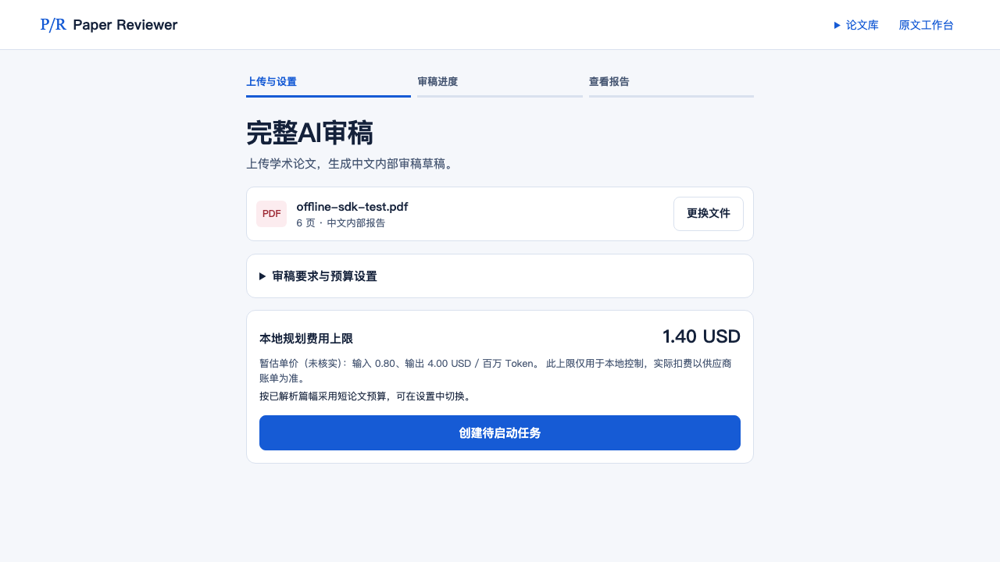
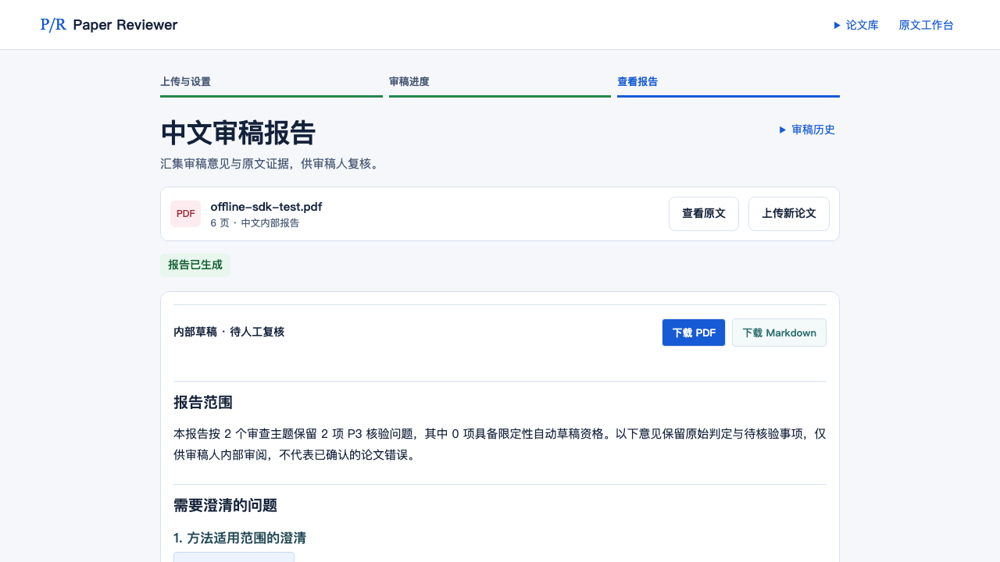
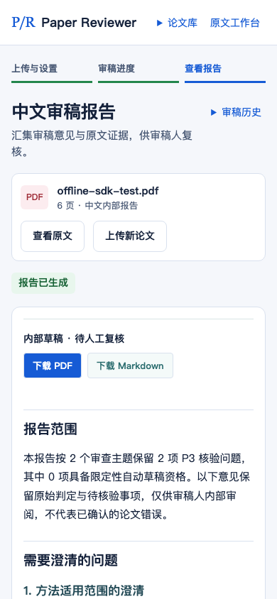

# 自动审稿性能优化：离线验收记录

状态：工程候选通过，真实5分钟性能和学术质量均未验证。零新增供应商调用；未重启或修改已停止的真实任务。此记录不替换历史P5评测结果。

## 对照方法

同一6页/14页开发论文、相同Fake SDK响应、相同阶段引擎及来源校验，在独立SQLite目录上传PDF，走真实FastAPI自动主链至中文internal草稿。只替换最外层SDK。PDF身份见`examples/auto-review/papers.json`。优化前为本轮改动前的工作树（已经包含此前34→30次的调整）；优化后开启最多2并发。两者都采用不阻碍工程覆盖的相同测试预算/速率（120请求/分钟、200万字节输入预留/分钟），不是付费预算建议。Fake延迟为0；以下毫秒仅反映本地解析、执行、持久化和固定响应处理。

|样本|请求数 前→后|输入消息UTF-8字节 前→后|精确重复System字节 前→后|本地上传至报告 前→后|
|---|---|---|---|---|
|6页|30→30|507,309→506,484（−825，0.16%）|17,250→17,250|3,109→3,278 ms|
|14页|50→45|1,190,257→1,144,041（−46,216，3.88%）|44,270→37,550（−6,720）|11,504→10,082 ms|

字节不是Token；精确重复System只是重复上下文的可计算下界。其余输入减少不能全部归因于重复科学文本删除。Fake响应的Token数字没有真实供应商计量意义。单次本地计时有噪声，不能从这张表推断网络等待加速或5分钟达标。两篇均为开发回归样本，不能称为盲测。

|阶段|6页 前→后|14页 前→后|每请求用途与依赖|
|---|---|---|---|
|P2-A|14→14|34→29|类型规划1；N2分块/汇总；来源一致性1；N3各块映射；贡献归一1|
|P2-B|6→6|6→6|六维各1，独立输出与Schema保留|
|P2-C|2→2|2→2|候选关系批次、全局调和；真实问题数变化会改变请求数|
|P3|6→6|6→6|本夹具2项任务各来源观察、反证、裁定；适用的技术提案/确定性工具仍保留，夹具不证明所有真实核验形态|
|P4|2→2|2→2|仅适用于小证据包的两主题internal写作合批1，加一致性1；更大/更多主题仍分批|

6页P2-A：规划1，理解4（含全局汇总），一致性1，映射7，归一1。14页优化后：规划1，理解9（含全局汇总），一致性1，映射17，归一1。未删任何阅读单元：6页N2/N3均261/261，14页均682/682，excluded_unit_ids均为空；source_quality仍为needs_review，所有来源局限保留。全覆盖不等于公式、表格或科学理解已人工确认。

## 已实现的重叠与关键路径

- 普通自动任务的N2独立分块、N3独立映射、六维审稿、独立VerificationTask使用最多2个worker的波次。所有依赖产物提交后才进入下一阶段；全局汇总、来源一致性、贡献归一、P2-C与P4仍顺序执行。
- 1–15页普通自动论文的N2分块上限18,000字符；N3保持9,000上限和完整证据映射。压缩JSON分隔空格，不删字段/原文。历史C1及独立阶段默认仍串行，不修改冻结科学Prompt。
- 不能无限增加并发：任务内预算和已派发预留、软件速率及未知费用都约束准入。网页新任务显式保存并发2；API未传策略默认1；已存在任务不被改写。供应商账户并发/RPM/TPM仍未核实，付费验收前必须确认，软件输入速率采用保守字节预留，不冒充真实TPM。
- 请求前SQLite原子预留，派发前再次检查Unknown与期限。Unknown先在进程中熔断再持久化；并发已派发伙伴可以按自身有效Usage结算，未派发不得继续。持久化异常也不能打开后续派发。重启将未核销派发视为未知，不重放。P3 PDF对象单线程拥有；P4仍使用原双账及对账。
- 持久化每阶段实际起止、每调用派发/结算/操作/输入字节/模型/Usage/成本；输入仅保留哈希，不新增正文审计。模型等待之和、区间并集、峰值并发分别计算。模型关键路径只指各顺序阶段的SDK区间并集，含传输/本地结算，排除本地组装；不能当端到端耗时。历史缺计时保留unknown。

## 已有真实瓶颈证据

只读历史已停止的14页任务：27条有效Usage调用的累计trace耗时1,238,463 ms（20.64分钟），不是完整P2-A或完整端到端运行。规划1次36,501 ms；理解14次561,760 ms；映射11次627,818 ms；一致性1次12,384 ms。单请求最慢166,653 ms。有效输入353,895、输出42,442 Token，本地暂估0.452884额度；另有1条未核销派发，不能计为零，供应商账单未知。

主要瓶颈是重复的P2-A模型等待及顺序依赖，而不是页面刷新。即使对相同历史请求集合做理想双并发，单看累计等待也不能推导出5分钟完成；本轮的分块改动、供应商排队及真实输出长度需要新授权样本验证。未取得真实P50/P90，不给出5分钟承诺。

## 测试与证据

- 完整后端：`python -m pytest backend/tests -q`：670 passed、4 skipped；未放宽Schema、证据或科学准入。
- 并发/预算/Unknown/全链路专项：`pytest -q backend/tests/test_auto_review_performance.py backend/tests/test_auto_review_full_chain.py`：29 passed。覆盖有效伙伴结算、未知/数据库异常熔断、并发预留、速率等待重检、重启不重放、P2-A/P2-B/P3实际重叠、来源覆盖和草稿生成。
- `cd frontend && npm run build`：通过（保留既有大chunk警告）。
- Playwright真实后端+Fake SDK：auto-review 2 passed；P4编辑/导出/审批确认隔离2 passed。核验中文报告、PDF证据高亮、MD/PDF实际下载、刷新不发模型及未知费用提示。测试服务在私有副本中；未调用生产供应商。
- 私有交付保存前后measurement.json、逐请求审计、产物/来源谱系、中文DRAFT、截图、历史脱敏计量、测试日志。基准记录Commit、工作树差异及源码树/Prompt/PDF哈希，不将未提交工作树误称为HEAD版本。

## 网页工程截图（全部为Fake SDK，非真实学术报告）

## 科学质量与下一次授权门槛

独立盲评表见`automatic-review-quality-rubric.md`。主要风险是N2更大分块可能丢失细节、并发供应商负载增加、小P4批次可能更易触达输出上限；Schema/覆盖验证不能排除这些科学质量退化。保留原输出上限和有效Usage内内容修复，不自动追加预算或重试网络失败。

工程已具备申请一次真实联合验收的候选条件；尚需独立代码复审、明确供应商并发/速率和账户风险、固定测试身份/预算及用户单独付费授权。真实速度与学术质量必须分别验收。当前5分钟性能：UNVERIFIED；学术质量：NOT EVALUATED；产品最终验收不因此升级为PASS。
